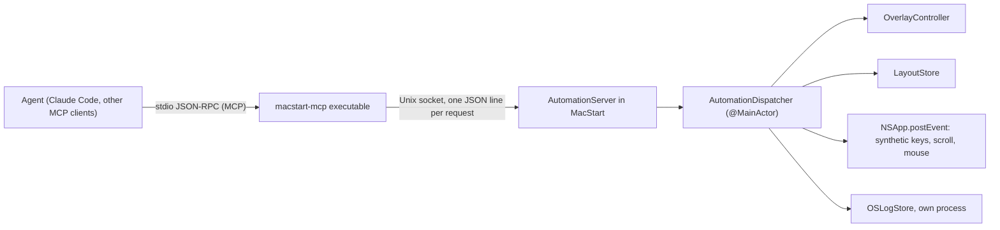

## Goal

Let agents drive the running MacStart app through MCP: test the overlay and its input, make layout edits, and read logs and state. Today the overlay, input, and layout editing are verified only by hand (`docs/architecture.md` → Testing Strategy says UI automation is out of scope). This is a possible future feature, parked until the developer schedules it.

Decisions already made by the developer:

- Scope: UI driving for tests, layout edits, and logs/state, all three.
- Exposure: an opt-in launch flag. The automation socket opens only when MacStart starts with `--automation`. Normal launches and login-item launches never listen. Rejected: debug builds only, a Settings toggle.
- App not running: every tool fails with a clear error. No offline edits of `layout.json`, and the MCP server never launches the app.

Constraints from `.agents/rules/stack.md`: no third-party packages (the MCP JSON-RPC is written by hand), Foundation-only shared code, no Accessibility, Input Monitoring, or Screen Recording permission, SPM only.

## Scope

### New targets in `Package.swift`

- `MacStartAutomation` library, Foundation and Darwin only:
  - `JSONValue` (Codable enum), `AutomationRequest { id, tool, arguments }`, `AutomationResponse { result | error, imagePNG? }`.
  - `AutomationTool` catalog: name, description, JSON input schema. The single source for MCP `tools/list` and for app-side argument validation.
  - `AutomationSocket`: POSIX `AF_UNIX` listen, accept, connect; newline-framed JSON; 4 MB line cap; socket file mode 0600 in a 0700 directory; stale socket removed on start.
  - `AutomationEndpoint.socketURL(profile:)`: `~/Library/Application Support/MacStart/automation.sock`, or `<profile>/automation.sock`. Rejects paths longer than 104 bytes (the `sun_path` limit).
  - `MCPServer`: JSON-RPC 2.0 over stdio with `initialize` (echo a supported protocol version, advertise `capabilities.tools`), `notifications/initialized`, `ping`, `tools/list`, `tools/call`. Text results are pretty JSON; `snapshot` returns MCP `image` content (base64 PNG). When the socket is missing: `isError: true` with "MacStart is not running with --automation. Start it with scripts/run-automation.sh."
- `macstart-mcp` executable: wires `MCPServer` to stdin/stdout and an `AutomationSocket` client, one connection per tool call. Logs go to stderr only, because stdout carries the protocol.
- `MacStartAutomationTests`: codec, MCP handshake, `tools/list`, error mapping, a socket round trip against a fake handler in a temporary directory.

### App side, `Sources/MacStart/Automation/`

- `AutomationLaunchOptions` parses `--automation` and an optional `--automation-profile <dir>` from `CommandLine.arguments`.
- Profile mode keeps the developer's real data untouched during agent tests:
  - layout at `<dir>/layout.json` through the existing `LayoutFileStore(fileURL:)`;
  - preferences in `UserDefaults(suiteName: "cc.summ.MacStart.automation")` through the existing `PreferencesStore(storage:)`;
  - skips `SettingsModel.applyLaunchAtLogin()` and the global hotkey, so it can run beside the normal MacStart, started with `open -n`.
- `AutomationServer`: accept loop on a dedicated thread. Each request hops to the main actor, and the reply is written back. The socket file is removed on quit.
- `AutomationDispatcher` (`@MainActor`) maps tools onto existing APIs. `AppDelegate.applicationDidFinishLaunching` creates it only when the flag is set. `AppDelegate.init` builds `LayoutStore` and `PreferencesStore`, so the profile choice is made there.
- Add `LogArea.automation`, and update `Tests/MacStartCoreTests/LogAreaTests.swift`, which lists every category.

### Tools

| Group | Tools | Implementation |
|---|---|---|
| State | `get_state`, `get_layout`, `find_app`, `snapshot`, `read_logs` | `OverlayState` (`isPresented`, `currentPage`, `query`, `selection`, `openFolderID`, `drag`) and `LayoutStore` (`layout`, `catalog`, `preferences`, `hasLoaded`). Layout through `LayoutStore.makeExport().jsonData()`. Snapshot through the panel's `contentView.cacheDisplay(in:to:)`, which needs no permission; the `NSVisualEffectView` blur is not drawn. Logs through `OSLogStore(scope: .currentProcessIdentifier)`, filtered by subsystem `cc.summ.MacStart`, category, level, and age |
| UI | `show_overlay`, `hide_overlay`, `toggle_overlay`, `press_key`, `type_text`, `go_to_page`, `swipe`, `scroll_wheel`, `click`, `drag`, `open_folder`, `close_folder` | Keys and text: `NSEvent.keyEvent` plus `NSApp.postEvent`, so the real local key monitor in `OverlayController.installEventMonitors` and the search field run. Swipe: `CGEvent` scroll events with the continuous flag and the scroll phase fields, converted with `NSEvent(cgEvent:)` and posted with real time gaps, so `PageSwipeTracking` sees real velocity. Wheel: non-continuous scroll events. Click and drag: mouse events for the panel's window number; a target is a point or an app name, its tile center from `GridMetrics.center(ofSlot:)` (top-left overlay coordinates; flip y for AppKit window coordinates). Show, hide, page: `OverlayController.show()`, `hide()`, `showPage(_:)` |
| Edit | `move_item`, `create_folder`, `remove_from_folder`, `move_in_folder`, `rename_folder`, `hide_app`, `unhide_app`, `set_preferences`, `export_state`, `import_state`, `rescan_catalog` | `LayoutStore.moveItem`, `dropApp`, `removeApp(fromFolder:at:)`, `moveApp(inFolder:from:to:)`, `renameFolder`, `hide`, `unhide`, `makeExport`, `applyImport`, `refreshCatalog`. Grid size through `SettingsModel.setGridColumns` / `setGridRows`; launch at login and the hotkey through `SettingsModel`, so their side effects run. Apps are addressed by bundle identifier or display name; locations as `{page, slot}` or `{folder, index}` (`LayoutLocation`, `GridPosition` in `MacStartCore`) |

UI tools take an optional `settleMs` (default about 400) and return the state after the action, so a test step is one call plus an assertion.

Things to know before building the UI tools:

- `OverlayController.windowDidResignKey` hides the overlay. The panel is a non-activating `NSPanel` that takes key focus without activating the app, so posted key events reach it while the agent's terminal stays frontmost.
- Most of `OverlayController` is private (`handleKey`, `handleScroll`, `openFolder`, `closeFolder`, `panel`). Add small internal accessors instead of making the input handlers public; synthetic input must go through the real monitors.
- Synthetic input posts events into MacStart's own queue only and changes no gesture, scroll, or drag handling. If SwiftUI's `DragGesture` in `OverlayView` ignores posted mouse events, `drag` falls back to `DragCoordinator.update(_:)` and `end()` with `DragUpdate` values, and `docs/automation.md` says so.
- The developer tests gesture, scroll, and drag changes one at a time. Ship `swipe`, `scroll_wheel`, `click`, and `drag` one by one for hand checks.
- The overlay covers the whole main display, so UI tests interrupt the developer's screen. Say so in the docs.

### Scripts and config

- `scripts/run-automation.sh`: runs `scripts/build-app.sh`, then `open -n build/MacStart.app --args --automation --automation-profile "$HOME/Library/Application Support/MacStart/automation-profile"`, then waits for the socket file.
- `scripts/macstart-mcp.sh`: `swift build --product macstart-mcp` with build output sent to stderr, then `exec` the binary.
- `.mcp.json` at the repository root registers server `macstart` with `scripts/macstart-mcp.sh`. Other agents use the same script; the docs say how, with no provider-specific copies.
- `scripts/build-app.sh` stays as it is. The release app carries the flag-gated code; `macstart-mcp` is a developer tool and is not bundled.

### Docs

- New `docs/automation.md`: launch, profile mode, tools, safety, limits. Add it to the doc table and commands in `AGENTS.md`.
- `docs/architecture.md`: source layout, a platform-choice row, and the Testing Strategy.
- `.agents/rules/stack.md`: a local Unix socket only under `--automation`, the `automation` log category, the allowed synthetic event use.
- If the choice passes the ADR test in `.agents/rules/documentation-and-diagrams.md`, ADR `docs/adr/0003-add-flag-gated-automation-mcp-server.md` and the index `docs/adr/README.md` (neither exists; 0001 and 0002 are in git history, deleted, and numbers are never reused). Otherwise the reasons go beside the facts in `docs/architecture.md`. Rejected alternatives: TCP or HTTP transport, Accessibility-based UI scripting, an AppleScript dictionary, a third-party MCP SDK, a Settings toggle, debug builds only.

### Suggested order

1. ADR draft.
2. `MacStartAutomation` with tests.
3. `macstart-mcp`, its wrapper script, `.mcp.json`.
4. App: launch options, profile mode, server, dispatcher with the state and edit tools.
5. UI tools: keys and text first, then swipe and wheel, then click and drag, each checked by the developer.
6. Docs, rules, ADR accepted.

## Acceptance Criteria

- `swift build`, `swift test`, `scripts/build-app.sh`, and `swift format lint -r Sources Tests` succeed.
- A normal launch (`open build/MacStart.app`) creates no socket file.
- With `scripts/run-automation.sh` running, every tool in the table works, and edits land in `<profile>/layout.json` while the real `~/Library/Application Support/MacStart/layout.json` stays unchanged.
- With no automation instance running, every tool returns the "not running" error.
- Docs, rules, and the ADR describe the feature.

## Verification

- Local checks: the four commands above.
- Pipe a scripted session into `scripts/macstart-mcp.sh`: `initialize`, `tools/list`, `get_state`, `show_overlay`, `type_text "saf"`, `get_state` shows the query, `press_key escape` twice, `get_state` shows the overlay hidden.
- In Claude Code after reloading MCP servers: `swipe` turns a page, `snapshot` returns an image, `create_folder` then `get_layout` shows the folder.
- Quit the automation instance; the next call returns the "not running" error.
- The developer confirms each input tool by hand.

## Notes

- Planned 2026-11-17; not started. Code references above match commit `841ea51`; check them again before starting.
