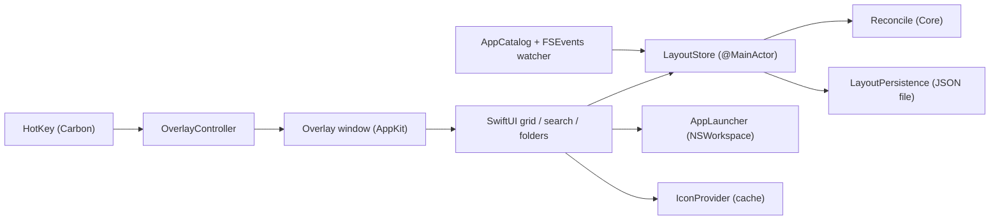
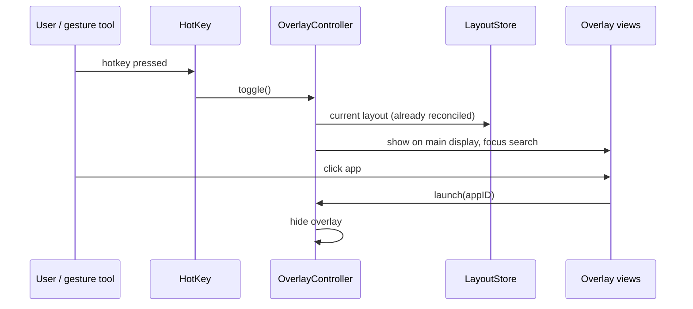

# Architecture

## System Shape

MacStart is a single-process macOS app with a Dock icon (activation policy `.regular`), like Launchpad. Clicking the Dock icon toggles the overlay. Hiding the overlay hands focus back to the previously active app. It is built entirely with Swift Package Manager. A script wraps the built executable into `MacStart.app` and signs it ad hoc. No Xcode project exists. Build commands are in [AGENTS.md](../AGENTS.md#commands), and tooling rules are in [stack.md](../.agents/rules/stack.md).



## Source Layout

```text
Package.swift
.swift-format              swift format configuration; owns the code style
Sources/
  MacStartCore/            Library. Foundation only: no AppKit, no SwiftUI.
    Model/                 AppID, InstalledApp, Catalog, Folder, Item, Page, Layout, Preferences
    Reconcile/             Pure reconcile and invariant checks
    Catalog/               App bundle scanning (FileManager + Bundle), and which file changes can change it
    Persistence/           JSON format, layout.json store, preferences store, export/import
    Search/                Search matching and ranking
    Navigation/            Keyboard selection across pages, and where a swipe lands
    Editing/               Moves, folders, batch edits for edit mode, hide and unhide
    LogArea.swift          Logger categories shared by both modules
  MacStart/                Executable. App entry and everything AppKit/SwiftUI.
    App/                   Entry point, AppDelegate, dependency wiring, LayoutStore
    Overlay/               Overlay window and controller, show/hide, display choice
    Features/
      Grid/                The overlay view, pages, tiles and hover, paging, search results, drag and
                           drop, the selection rectangle
      Folders/             Folder panel, its zoom, rename
      Editing/             Edit mode: badges, the action bar, selection menus
      Settings/            Settings window panes: shortcut, launch at login, grid size, Reset Layout,
                           hidden apps, backup
    Platform/              Thin adapters: GlobalHotKey, CatalogWatcher, IconProvider,
                           SurfaceImage, AppLauncher, LoginItem, KeyNames
Tests/
  MacStartCoreTests/       Swift Testing; reconcile, editing, search, navigation, codec, catalog scan fixtures
Support/
  Info.plist               Bundle metadata; copied into the .app by the build script
  AppIcon.iconset/         Placeholder icon PNGs; converted to AppIcon.icns with iconutil
scripts/
  build-app.sh             swift build, assemble MacStart.app, ad hoc codesign
  make-placeholder-icon.swift  Draws the placeholder AppIcon.iconset
.github/workflows/
  build.yml                CI: build, test, package, artifact, release on tag
```

This is the layout as built.

## Module Boundaries

- `MacStart` depends on `MacStartCore`. `MacStartCore` never imports `MacStart`, AppKit, or SwiftUI.
- The domain rules (reconcile, the invariants, the export format) live only in `MacStartCore`, so they can be tested headless.
- Platform adapters in `MacStart/Platform/` wrap a single system API each and expose a small protocol, so view models can be tested with fakes.
- SwiftUI views hold no business logic. They call `LayoutStore`, which owns the single mutable `Layout`.

## Key Platform Choices

| Concern | Choice | Reason |
|---------|--------|--------|
| Global hotkey | Carbon `RegisterEventHotKey` | Works without Accessibility permission |
| Overlay window | Borderless, non-activating `NSPanel` hosting SwiftUI through `NSHostingView`, at window level `statusBar + 1` (above the Dock and menu bar, below pop-up menus), joining the active Space and full-screen Spaces | Covers the whole screen like Launchpad, while context menus still appear on top |
| Focus | The panel takes keyboard focus without activating MacStart. When MacStart was active, as after a Dock click, hiding the overlay activates the previously active app | The app the user was in stays active underneath |
| Paging | A custom pager: the pages sit in one row that a two-finger swipe moves with the fingers, then a spring settles it on a page (`PageSwipe` decides which). Not SwiftUI's paging scroll view. A page turn and the state that goes with it, such as the keyboard selection, the drag's page, or the edit whose result the turn shows, change in one SwiftUI transaction | The paging scroll view needed long swipes and gave no control over the decision. Changed in two transactions, SwiftUI could draw the pager with the old page and then miss the new one |
| Smooth motion | Swipe offset and drag pointer are separate state, read only in small modifiers. Icons are pre-sized bitmaps, drawn off the main actor after each scan and when the overlay opens. Only label text has a shadow. The settle spring starts at the swipe's speed. Every page is built, not only the pages near the shown one | Swipe and drag frames move views without rebuilding or re-rendering the tiles, opening the overlay draws no icons, and a flick flows into the settle. With a few pages, lazy pages save little, and they would have to keep every page built that a long swipe or an interrupted jump across pages can show |
| Keyboard | A local key monitor takes the arrow keys, Return, and Escape before the focused search field; every other key goes to the field | Typing searches at once, while the grid stays keyboard driven |
| Drag and drop | One SwiftUI drag gesture for the whole overlay, with a coordinator that finds the tile whose cell holds the press; not system drag and drop, so icons make room live. Tiles carry no gestures, so a folder panel closes as soon as a drag leaves it. A full page opens no gap, so a drop never pushes icons to the next page (see the editing rules in [domain-model.md](domain-model.md#editing)) | Launchpad-like reflow, folder creation by resting on an icon, and page turns at the screen edges |
| Show and hide animation | The content view's layer fades, and the SwiftUI content zooms from 1.06 through its layer's `sublayerTransform`, each with an explicit Core Animation animation after its final value is set | `NSWindow.animator()` alpha can stall at its start value, for example while the display sleeps, which would leave an invisible overlay. A SwiftUI scale redrew every label at each frame's size, and CoreGraphics keeps the glyphs of every size it draws: about 0.3 MB and 0.14 s of CPU per show and hide |
| Folder zoom | One animatable modifier zooms the open folder's panel in and out and tells the views inside while it zooms. Meanwhile an image of the folder's name and apps zooms in their place, drawn once per zoom by one shared `ImageRenderer`, which places layers on whole pixels as the window does | A SwiftUI zoom of the live views redrew their text at each frame's size, and CoreGraphics keeps the glyphs of every size it draws: about 0.5 MB per open and close. A transition does not tell the views inside that it runs. Each new `ImageRenderer` keeps about 1 MB of graphics memory, and drawing into a context of its own puts the image up to a pixel off |
| Target display | `NSScreen.screens.first`, the display that holds the menu bar | `NSScreen.main` follows keyboard focus, which is not the main display |
| Background | `NSVisualEffectView` blur behind the grid | Native look like Launchpad |
| App discovery | Scan `/Applications`, `/System/Applications`, `~/Applications` up to five levels deep (never into `.app` bundles), plus FSEvents watching on those roots, debounced by a 2-second FSEvents latency. A change inside a bundle, below its `Contents` folder, or below the scan depth starts no rescan | One code path handles the full scan and later updates, which keeps the list free of duplicates. FSEvents reports every write inside a bundle, such as an install in progress, and a scan of every folder took 0.4 s with one Unity install |
| Launching | `NSWorkspace.openApplication(at:configuration:)` | |
| Icons | `NSWorkspace.icon(forFile:)` on the bundle URL, drawn into an IOSurface-backed bitmap and cached in memory by path and version. Icons of apps that left the catalog go when the overlay prewarms, and all of them when the grid's icon size or the display scale changes | An updated app gets its new icon. Core Animation shows an IOSurface without copying it; from ordinary memory, it keeps a second copy of every icon it shows |
| Layout storage | `~/Library/Application Support/MacStart/layout.json`, written atomically | Human-readable, and uses the same format as export |
| Preferences | `Preferences` value in `MacStartCore`, stored in `UserDefaults` | Small settings, included in export |
| Dock icon | `applicationShouldHandleReopen` toggles the overlay; `applicationDockMenu` adds Settings | Same entry point as Launchpad |
| Launch at login | `SMAppService.mainApp`, toggled in Settings. Every launch makes the registration match the preference, which registers it on the first launch (the one with no saved preferences) and again after an update | On by default; each ad hoc signed build has a new signature that can invalidate the old registration |
| Shortcut names | `UCKeyTranslate` with the current keyboard layout, plus symbols for special keys | Shows the key the user's layout types, like macOS menus do |

## Data Flow



Catalog changes from FSEvents trigger a rescan, then `LayoutStore` reconciles and saves. All layout mutations go through `LayoutStore` on the main actor. Scanning and file I/O run off the main actor.

## Footprint

MacStart runs from login to logout, so it must cost nothing at hold and must not grow with use.

- At hold there are no timers, display links, or polling: 0% CPU, no wakeups, and about 65 MB, measured with 95 tiles and 115 apps on macOS 27.2. Opening the overlay or a folder, however often, must leave it there.
- To check the running app, which needs no debugger, use `footprint <pid>`, `vmmap --summary <pid>`, and `top -l 2 -s 15 -pid <pid> -stats pid,cpu,idlew,mem`. Read them right after launch and after a day of use.
- To measure the overlay without the developer's display, run a copy of `Sources/` whose panel is ordered in 40,000 pt off every display, never key, in a process with the `.prohibited` activation policy. With `MallocStackLogging=1`, `heap` then names what grows. Snapshots from `cacheDisplay` draw no blurs or materials.
- Large view trees zoom in Core Animation or through an image of them; see [the SwiftUI conventions](../.agents/rules/code-conventions-swift-macos.md#swiftui), and the show and hide animation and folder zoom rows above.
- The overlay's views stay built while it is hidden. Releasing them saved no footprint, because the freed memory stays dirty in malloc, and each show then took about 60 ms instead of 18 ms.
- No zoom uses `drawingGroup`: over 50 folder opens it grew the footprint from 88 to 273 MB, and the glyphs still grew.
- Each SwiftUI context menu that is shown keeps about 20 KB, because `ContextMenuResponder` and its `AppKitMenuDelegate` keep each other alive. It is a framework bug, accepted.

## Testing Strategy

- Unit tests cover `MacStartCore`: reconcile invariants, duplicate collapsing, the export/import round trip, schema version rejection, catalog scanning against temporary bundle fixtures, and which FSEvents paths start a rescan. A seeded random test reconciles hundreds of random layouts and checks every invariant.
- The overlay, hotkey, input, and settings are checked by hand by the developer, in the built app with the display awake. UI automation is out of scope for now. How agents take part in these checks: `.agents/rules/workflow.md`.
- Manual checks, by area:
  - Overlay: Option-S and the Dock icon toggle it over the whole main display, including the menu bar and the Dock, also over a full-screen app. A click on an app launches it. A click between icons, Escape, switching apps, or switching Spaces closes it, and the previous app gets the focus back. A two-finger swipe, a mouse wheel, the arrow keys at the page edge, and the page dots change pages.
  - Search and keyboard: typing filters at once, the best match comes first, and Return launches it. The arrow keys move through the results and the grid. Escape clears the search before it closes the overlay. Hidden apps never show up. Apps that share a name show their version. VoiceOver reads names and the selection, and Increase Contrast adds outlines and stronger dimming.
  - Organizing: a drag shifts the other icons live, and the drop lands in the gap, also on another page after resting at a screen edge. Resting on an app makes a folder named after its category; resting on a folder adds to it. A folder opens on a click, renames in place, and closes with a click outside or Escape. A drag inside a folder reorders it, and a drag out places the app in the grid. A click launches; a drag never does.
  - Edit mode: New Folder, Remove from Folder, Move to (a page or a folder), and Hide act on the selection and leave the shown page and the open folder in place; a folder closes only when the edit dissolves it. Folders that share a name show their first apps in the Move to menu.
  - Settings: `⌘,` and the Dock icon's menu open it and close the overlay. The shortcut recorder takes a new shortcut, which still works after a restart; Escape cancels, and a plain letter is refused. Open at login adds and removes the login item. Picking a grid size asks to confirm and then reflows the pages. Hide and Unhide work, with search and multiple selection. Export writes a file; Import asks to confirm and restores it; a file that is not a backup shows an alert.
