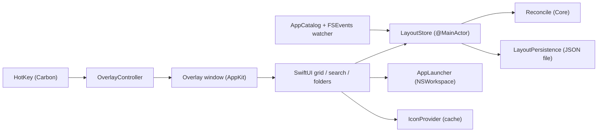
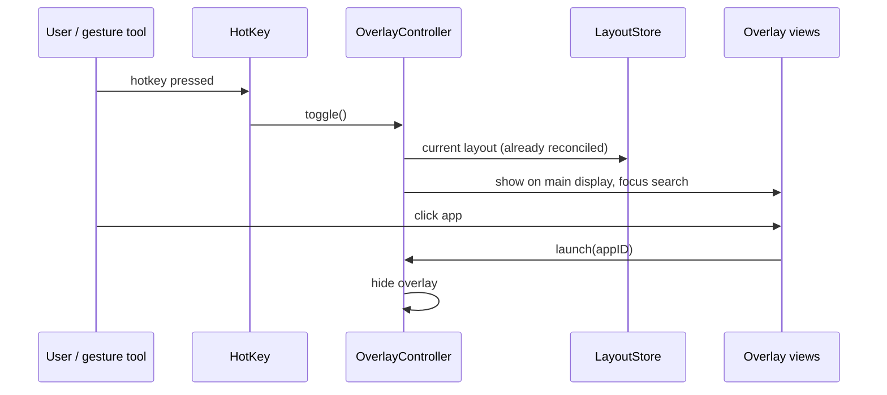

# Architecture

## System Shape

MacStart is a single-process macOS app with a Dock icon (activation policy `.regular`), like Launchpad. Clicking the Dock icon toggles the overlay. Hiding the overlay hands focus back to the previously active app. It is built entirely with Swift Package Manager. A script wraps the built executable into `MacStart.app` and signs it ad hoc. No Xcode project exists. Build commands are in [AGENTS.md](../AGENTS.md#commands), and tooling rules are in [stack.md](../.agents/rules/stack.md).



## Source Layout

```text
Package.swift
.swift-format              swift format configuration; owns the code style
Sources/
  MacStartCore/            Library. Foundation only: no AppKit, no SwiftUI.
    Model/                 AppID, InstalledApp, Catalog, Folder, Item, Page, Layout, Preferences
    Reconcile/             Pure reconcile and invariant checks
    Catalog/               App bundle scanning (FileManager + Bundle)
    Persistence/           JSON format, layout.json store, preferences store, export/import
    Search/                Search matching and ranking
    Navigation/            Keyboard selection across pages, and where a swipe lands
    Editing/               Moves, folder creation, and folder edits from drag and drop
    LogArea.swift          Logger categories shared by both modules
  MacStart/                Executable. App entry and everything AppKit/SwiftUI.
    App/                   Entry point, AppDelegate, dependency wiring, LayoutStore
    Overlay/               Overlay window and controller, show/hide, display choice
    Features/
      Grid/                Pages, icons, paging, drag and drop
      Folders/             Folder open/close, rename
      Search/              Type-to-search, keyboard navigation
      Settings/            Hotkey, grid size, launch at login, hidden apps, export/import
    Platform/              Thin adapters: GlobalHotKey, CatalogWatcher, IconProvider,
                           AppLauncher, LoginItem, KeyNames
Tests/
  MacStartCoreTests/       Swift Testing; reconcile, codec, catalog scan fixtures
Support/
  Info.plist               Bundle metadata; copied into the .app by the build script
  AppIcon.iconset/         Placeholder icon PNGs; converted to AppIcon.icns with iconutil
scripts/
  build-app.sh             swift build, assemble MacStart.app, ad hoc codesign
  make-placeholder-icon.swift  Draws the placeholder AppIcon.iconset
.github/workflows/
  build.yml                CI: build, test, package, artifact, release on tag
```

These folders are the agreed layout. They are created as the code is written.

## Module Boundaries

- `MacStart` depends on `MacStartCore`. `MacStartCore` never imports `MacStart`, AppKit, or SwiftUI.
- The domain rules (reconcile, the invariants, the export format) live only in `MacStartCore`, so they can be tested headless.
- Platform adapters in `MacStart/Platform/` wrap a single system API each and expose a small protocol, so view models can be tested with fakes.
- SwiftUI views hold no business logic. They call `LayoutStore`, which owns the single mutable `Layout`.

## Key Platform Choices

| Concern | Choice | Reason |
|---------|--------|--------|
| Global hotkey | Carbon `RegisterEventHotKey` | Works without Accessibility permission |
| Overlay window | Borderless, non-activating `NSPanel` hosting SwiftUI through `NSHostingView`, at window level `statusBar + 1` (above the Dock and menu bar, below pop-up menus), joining the active Space and full-screen Spaces | Covers the whole screen like Launchpad, while context menus still appear on top |
| Focus | The panel takes keyboard focus without activating MacStart. When MacStart was active, as after a Dock click, hiding the overlay activates the previously active app | The app the user was in stays active underneath |
| Paging | A custom pager: the pages sit in one row that a two-finger swipe moves with the fingers, then a spring settles it on a page (`PageSwipe` decides which). Not SwiftUI's paging scroll view. A page turn and the state that goes with it, such as the keyboard selection or the drag's page, change in one SwiftUI transaction | The paging scroll view needed long swipes and gave no control over the decision. Changed in two transactions, SwiftUI could draw the pager with the old page and then miss the new one |
| Smooth motion | Swipe offset and drag pointer are separate state, read only in small modifiers. Icons are pre-sized bitmaps, drawn off the main actor after each scan and when the overlay opens. Only label text has a shadow. The settle spring starts at the swipe's speed | Swipe and drag frames move views without rebuilding or re-rendering the tiles, opening the overlay draws no icons, and a flick flows into the settle |
| Keyboard | A local key monitor takes the arrow keys, Return, and Escape before the focused search field; every other key goes to the field | Typing searches at once, while the grid stays keyboard driven |
| Drag and drop | Custom SwiftUI drag gestures with a coordinator, not system drag and drop, so icons make room live. Pages are not lazy, and a folder panel stays invisible during a drag out of it, because removing the dragged tile would end its gesture | Launchpad-like reflow, folder creation by resting on an icon, and page turns at the screen edges |
| Show and hide animation | The content view's layer fades with an explicit Core Animation fade, after its final opacity is set; SwiftUI scales the content | `NSWindow.animator()` alpha can stall at its start value, for example while the display sleeps, which would leave an invisible overlay |
| Target display | `NSScreen.screens.first`, the display that holds the menu bar | `NSScreen.main` follows keyboard focus, which is not the main display |
| Background | `NSVisualEffectView` blur behind the grid | Native look like Launchpad |
| App discovery | Scan `/Applications`, `/System/Applications`, `~/Applications` recursively (skipping into `.app` bundles), plus FSEvents watching on those roots, debounced by a 2-second FSEvents latency | One code path handles the full scan and later updates, which keeps the list free of duplicates |
| Launching | `NSWorkspace.openApplication(at:configuration:)` | |
| Icons | `NSWorkspace.icon(forFile:)` on the bundle URL, cached in memory by path and version | An updated app gets its new icon |
| Layout storage | `~/Library/Application Support/MacStart/layout.json`, written atomically | Human-readable, and uses the same format as export |
| Preferences | `Preferences` value in `MacStartCore`, stored in `UserDefaults` | Small settings, included in export |
| Dock icon | `applicationShouldHandleReopen` toggles the overlay; `applicationDockMenu` adds Settings | Same entry point as Launchpad |
| Launch at login | `SMAppService.mainApp`, toggled in Settings. Every launch makes the registration match the preference, which registers it on the first launch and again after an update | On by default; each ad hoc signed build has a new signature that can invalidate the old registration |
| Shortcut names | `UCKeyTranslate` with the current keyboard layout, plus symbols for special keys | Shows the key the user's layout types, like macOS menus do |

## Data Flow



Catalog changes from FSEvents trigger a rescan, then `LayoutStore` reconciles and saves. All layout mutations go through `LayoutStore` on the main actor. Scanning and file I/O run off the main actor.

## Testing Strategy

- Unit tests cover `MacStartCore`: reconcile invariants, duplicate collapsing, the export/import round trip, schema version rejection, and catalog scanning against temporary bundle fixtures. A seeded random test reconciles hundreds of random layouts and checks every invariant.
- The overlay, hotkey, and launching are verified manually by building and running the app. UI automation is out of scope for now.
