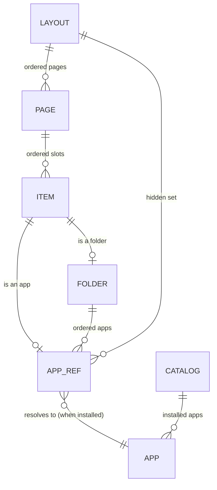

# Domain Model

## Entities



| Entity | Fields | Notes |
|--------|--------|-------|
| `AppID` | standardized bundle path + bundle identifier (if any) | The identity used everywhere in the layout. Two IDs are equal when their paths are equal, so every bundle on disk is a separate app. The bundle identifier lets reconcile follow an app that moved. |
| `InstalledApp` | id, display name, version, bundle URL | Comes from the catalog and is never persisted. The display name is the localized name Finder shows. The version is `CFBundleShortVersionString`. For an app found through a symbolic link, the bundle URL is the link's target, used for icons and launching. The icon is loaded on demand. |
| `Catalog` | set of `InstalledApp` keyed by `AppID` | Rebuilt by scanning the app locations, see [Catalog Scan](#catalog-scan). |
| `Folder` | stable UUID, name, ordered `[AppID]` | |
| `Item` | `.app(AppID)` or `.folder(Folder)` | |
| `Page` | ordered `[Item]` | Holds at most rows × columns items. |
| `Layout` | ordered `[Page]`, hidden `Set<AppID>` | Persisted in `layout.json` together with a schema version. |
| `Preferences` | hotkey (virtual key code + modifiers, default `⌥S`), grid columns × rows (default 7 × 5, columns 3–15, rows 2–10), launch at login (default on) | Persisted in `UserDefaults`. |
| `Export` | schema version, exported-at timestamp, `Layout`, `Preferences` | The complete state of the app, written to one file. |

## Invariants

1. Each `AppID` appears at most once in the layout, counting every page and every folder together.
2. An `AppID` is either placed in the layout or in the hidden set, never both.
3. Every placed `AppID` resolves to an installed app after reconcile.
4. A folder holds at least 2 apps. A folder left with 1 app dissolves into a plain item in the same slot. A folder left with 0 apps is removed.
5. No page is empty except page 1 when nothing is installed. Empty trailing pages are removed.
6. A page never holds more items than the grid capacity (columns × rows from `Preferences`). Extra items move onto the next page. When the grid size shrinks, the overflow cascades forward and order is preserved.

Reconcile enforces all six invariants. It runs after every catalog change, after an import, and at launch.

## Reconcile

Input: the catalog and the stored layout. Output: a layout that satisfies every invariant.

1. Collapse duplicates. When an `AppID` appears more than once, keep the first occurrence in reading order (page, then slot, then position inside the folder) and drop the rest. A placed app that is also hidden leaves the grid: hidden wins.
2. Match stored `AppID`s to the catalog, placed and hidden alike:
   - First, by exact path.
   - Then rebind the leftovers. If a stored entry has no path match, and its bundle identifier matches exactly one catalog app that is still unmatched, the entry takes that app's path. This covers an app moved between folders, or an export imported on a Mac with different install paths.
   - Entries are matched in a fixed order: placed entries in reading order, then hidden entries by path. When two leftovers could rebind to the same app, the earlier one wins.
   - A matched entry takes the catalog's `AppID`, so a changed bundle identifier at the same path is picked up.
   - Placed entries that are still unmatched are removed.
3. Keep unmatched hidden `AppID`s even when the app is uninstalled, so a reinstalled app stays hidden.
4. Append catalog apps that are neither placed nor hidden to the end of the last page, sorted by display name in Finder order, with ties broken by path.
5. Fix folders and pages as invariants 4–6 require.

Reconcile is a pure function from (catalog, layout, page capacity) to layout. It is unit tested without AppKit, including a seeded random test that checks every invariant and that a second reconcile changes nothing.

## Duplicate Bundles

Every `.app` bundle on disk is a separate app with its own icon, even when several bundles share one bundle identifier. Examples: a beta and a release build installed side by side, or two copies in different folders. Duplicate icons can come only from one bundle being entered twice, and invariant 1 rules that out.

When several bundles share a name, the grid shows the bundle version (`CFBundleShortVersionString`) as a subtitle so they can be told apart.

## Catalog Scan

The catalog holds every `.app` bundle with an `Info.plist` under `/Applications`, `/System/Applications`, and `~/Applications`:

- Folders are scanned recursively, but never inside a bundle, so helper apps inside other apps are not listed.
- Names starting with a dot are skipped. The hidden file flag is ignored, because `/Applications/Safari.app` is a symbolic link that carries it.
- A bundle without an `Info.plist` cannot be launched and is skipped. Some developer tools install such template bundles.
- A symbolic link to an app counts as that app, under the link's path. When a link and its target are both inside the scanned folders, the app is listed once, under the target's path.
- Wrapped iOS apps are read through their `WrappedBundle` link.
- Background-only and menu bar apps are listed like any other app. The user hides the ones they never launch.

## Search

Search matches only placed apps, including apps inside folders. Hidden apps never appear in results.

## Export And Import Format

- A single UTF-8 JSON file, extension `.json`, holding the full `Export`: `schemaVersion`, `exportedAt` (ISO 8601, UTC), `layout`, and `preferences`. The goal is a complete migration to a new Mac with one import.
- Folders, pages, and hidden apps refer to apps by `AppID` (path + bundle identifier). Icons are never exported. On a new Mac, apps installed at different paths are rebound by bundle identifier during reconcile.
- An import validates the schema version, replaces the current layout and preferences, re-registers the hotkey, applies the launch-at-login setting, and then runs reconcile. Apps that are missing on this Mac are dropped from placement but stay in the hidden set.
- An unknown or newer schema version is rejected with a user-facing error, and the current layout and preferences are left untouched.

### File Format

An export file in schema version 1:

```json
{
  "exportedAt" : "2026-11-16T12:00:00Z",
  "layout" : {
    "hidden" : [
      { "bundleIdentifier" : "com.apple.Chess", "path" : "/System/Applications/Chess.app" }
    ],
    "pages" : [
      {
        "items" : [
          { "app" : { "bundleIdentifier" : "com.apple.Safari", "path" : "/Applications/Safari.app" } },
          {
            "folder" : {
              "apps" : [
                { "bundleIdentifier" : "com.apple.Notes", "path" : "/System/Applications/Notes.app" },
                { "path" : "/Applications/Unsigned Tool.app" }
              ],
              "id" : "5B0B7D6E-8F0A-4C1E-9C3B-2F1D4E5A6B7C",
              "name" : "Work"
            }
          }
        ]
      }
    ]
  },
  "preferences" : {
    "gridColumns" : 7,
    "gridRows" : 5,
    "hotKey" : { "keyCode" : 1, "modifiers" : [ "option" ] },
    "launchAtLogin" : true
  },
  "schemaVersion" : 1
}
```

- Files are written pretty-printed with sorted keys, and hidden apps are sorted by path, so the same state always gives the same file.
- `exportedAt` is ISO 8601 in UTC, in whole seconds.
- An item is an object with exactly one key, `app` or `folder`. `bundleIdentifier` is left out when the bundle has none.
- `keyCode` is the virtual key code (`kVK_*`, `0x01` is S). `modifiers` lists `control`, `option`, `shift`, and `command`, in that order.
- `layout.json` holds `{ "schemaVersion" : 1, "layout" : { ... } }`. The preferences are stored as the JSON string `{ "schemaVersion" : 1, "preferences" : { ... } }` under the `UserDefaults` key `preferences`.
- Reading rejects invalid JSON, a missing field, a relative app path, a grid size outside the allowed ranges, an unknown modifier, and an item that is neither an app nor a folder. Stored preferences that cannot be read are replaced by the defaults.
