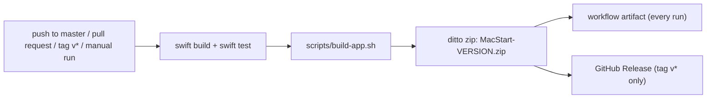

# Operations

MacStart is built either locally or by GitHub Actions. The developer downloads the built app from GitHub and installs it on their own Mac. Local build commands are in [AGENTS.md](../AGENTS.md#commands).

## CI Build

Workflow file: `.github/workflows/build.yml`.



- **Runner:** `runs-on: xcode-27`. This is GitHub's public-preview image with macOS 27 on Apple silicon. Its default Xcode is 27.1, so the workflow first runs `sudo xcode-select -s /Applications/Xcode_27.2.app`. When a stable `macos-27` label exists, switch to it.
- **Cost:** standard GitHub-hosted runners are free for public repositories.
- **Steps:**
  1. Check out the code.
  2. Select Xcode 27.2.
  3. Run `swift build`.
  4. Run `swift test`.
  5. Run `scripts/build-app.sh`.
  6. Zip with `ditto -c -k --keepParent build/MacStart.app MacStart-<version>.zip`. Use `ditto`, not `zip`: it preserves the code signature and the bundle's symlinks.
  7. Upload the zip as a workflow artifact.
- **Release:** a pushed tag `vX.Y.Z` also runs the `release` job on `ubuntu-latest`. It downloads the zip artifact and creates a GitHub Release with the zip attached. Only that job gets `permissions: contents: write`; the build job can only read.
- **No secrets:** the app is signed ad hoc, so the workflow uses no signing certificates.

## Versioning

- `CFBundleShortVersionString`: `X.Y.Z` taken from the tag `vX.Y.Z`. Untagged builds use `0.0.0`.
- `CFBundleVersion`: the GitHub Actions run number. Local builds use `0`.
- `scripts/build-app.sh` reads both values from the environment variables `MACSTART_VERSION` and `MACSTART_BUILD` and writes them into the bundled `Info.plist`.

## Install

Recommended: download with the GitHub CLI. Command-line downloads carry no quarantine flag, so Gatekeeper does not block the ad hoc signed app.

```bash
gh release download --repo Temosh/mac-start --pattern 'MacStart-*.zip' --dir /tmp/macstart
```

```bash
ditto -x -k /tmp/macstart/MacStart-*.zip /Applications
```

A build from an untagged run is available as a workflow artifact:

```bash
gh run download --repo Temosh/mac-start --name MacStart
```

Downloading with a browser marks the zip as quarantined. macOS then refuses to open the app because it is not notarized. To allow it once, use System Settings → Privacy & Security → Open Anyway, or run:

```bash
xattr -dr com.apple.quarantine /Applications/MacStart.app
```

## Update

1. Quit MacStart.
2. Replace `/Applications/MacStart.app` with the new build, the same way as Install.
3. Start MacStart again.

The layout and preferences live outside the bundle (see [stack.md](../.agents/rules/stack.md#persistence)), so they survive the update.

Each ad hoc signed build has a new code signature, which can invalidate the launch-at-login registration. MacStart checks the registration at every launch and registers again while the preference is on. macOS may show a Background Items notification when it does.
